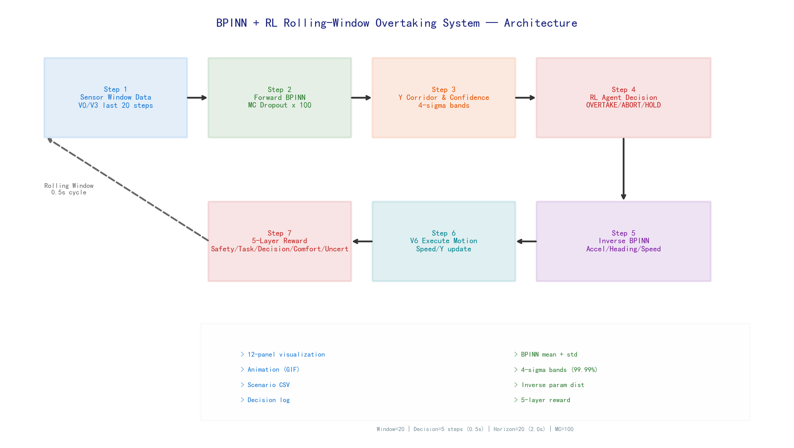
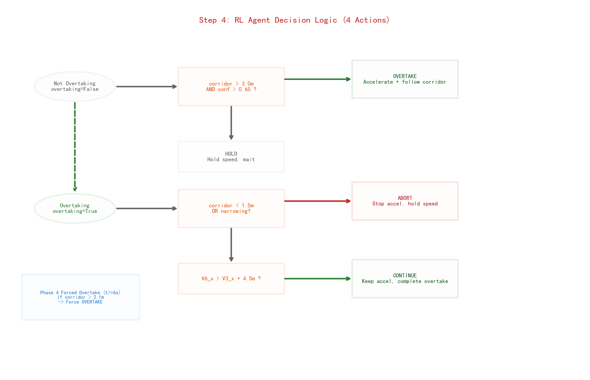
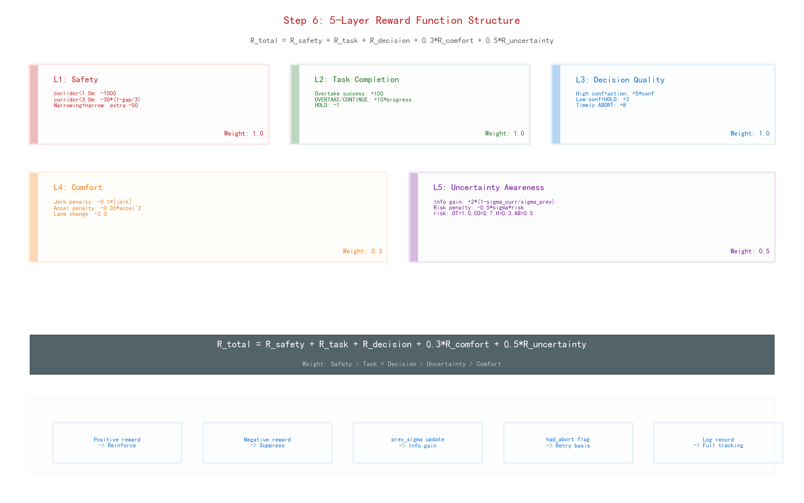
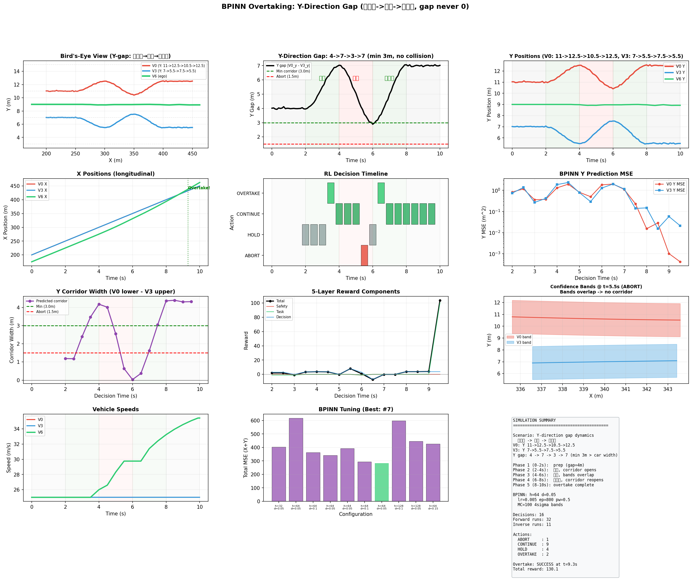
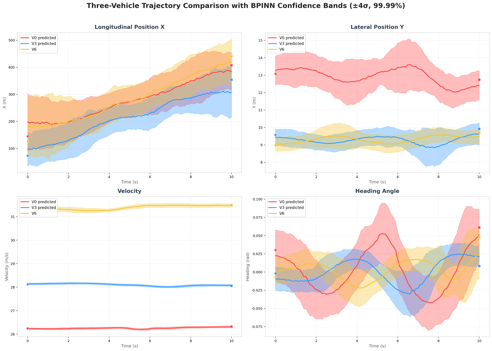

# BPINN + RL Overtaking System

A **Bayesian Physics-Informed Neural Network (BPINN)** framework for safe autonomous overtaking, combining physics-constrained trajectory prediction, uncertainty quantification via Monte Carlo Dropout, and an uncertainty-aware **Reinforcement Learning decision layer** in a rolling-window closed-loop simulation.

Built as a SURF (Summer Undergraduate Research Fellowship) research project on *Bayesian Physics-Informed Neural Networks for Real-World Nonlinear Dynamical Systems*.

**Try the interactive demo:** open [`demo/bpinn_interactive_overtaking.html`](demo/bpinn_interactive_overtaking.html) in any browser.

## System Architecture



The system runs a receding-horizon loop:

1. **Perception** — a 20-step (2.0 s) rolling sensor window collects noisy position observations of surrounding vehicles (V0 lead, V3 reference)
2. **Forward BPINN** — a physics-informed network predicts each vehicle's future state `[x, y, v, θ]` over a 2.0 s horizon. **MC Dropout** (100 stochastic passes) yields a predictive distribution, producing mean trajectory `μ(t)` and epistemic uncertainty `σ(t)`
3. **Uncertainty-aware safety corridor** — the lateral overtaking corridor is extracted as the gap between the confidence bands of the two vehicles:
   `safe_lower(t) = μ_y^V3(t) + k·σ_y^V3(t) + margin`, `safe_upper(t) = μ_y^V0(t) − k·σ_y^V0(t) − margin`
4. **RL decision layer** — at every 0.5 s decision point the agent selects one of four actions: **OVERTAKE / CONTINUE / ABORT / HOLD**, gated by corridor feasibility
5. **5-layer reward function** — safety, task completion, decision quality, comfort, and uncertainty, with safety dominating task completion
6. **Execution & re-plan** — the planned trajectory (monotone PCHIP interpolation, clamped to the corridor) is executed for one decision interval, then the loop repeats

Physics constraints are embedded directly into the training loss via JAX automatic differentiation:

```
dx/dt = v·cos(θ),   dy/dt = v·sin(θ)
L = L_data + λ · L_physics
```

## Scenario & Closed-Loop Behavior

The demonstration scenario encodes lateral gap dynamics (widen → narrow → reopen):

| Phase | Time | Y-gap | Agent behavior |
|---|---|---|---|
| 1 | 0–2 s | 4 m | **HOLD** — corridor too narrow |
| 2 | 2–4 s | 7 m | V6 accelerates, prepares overtake |
| 3 | 4–6 s | 2 m | **ABORT** — confidence bands overlap, no safe path |
| 4 | 6–8 s | 7 m | Corridor reopens → **OVERTAKE** |
| 5 | 8–10 s | — | Maneuver completed, no collisions |

| RL Decision Logic | 5-Layer Reward |
|---|---|
|  |  |

## Results

<p align="center">
  
</p>

Full closed-loop animation (confidence bands evolve in real time): [`results/bpinn_overtaking_complete_animation.gif`](results/bpinn_overtaking_complete_animation.gif)

Vehicle-level comparison with uncertainty bands from the same BPINN:

<p align="center">
  
</p>

3D corridor visualization and a bird's-eye view: [`results/overtaking_3d_final.png`](results/overtaking_3d_final.png) · [`results/birdview_2d_overtaking.png`](results/birdview_2d_overtaking.png)

## Repository Structure

```
├── src/
│   ├── bpinn_complete_overtaking.py        # MAIN: rolling-window BPINN+RL closed-loop simulation
│   ├── rolling_window_scenario.py          # rolling-window scenario generator (gap dynamics)
│   ├── rolling_window_bpinn_simulation.py  # rolling-window BPINN simulation framework
│   ├── bpinn_overtaking_system_v2.py       # forward BPINN + Optuna tuning + inverse parameter estimation
│   ├── overtaking_scene_analysis.py        # 3-vehicle scene extraction from raw highway data
│   ├── birdview_2d_overtaking.py           # bird's-eye-view visualization
│   ├── vehicle_comparison_with_confidence.py  # per-vehicle BPINN comparison with confidence bands
│   └── overtaking_3d_diagram_v4.py         # 3D corridor diagram
├── data/                                    # scenario CSVs + raw highway trajectories
├── results/                                 # final figures + animation
├── diagrams/english/                        # 9 architecture diagrams (200 DPI)
├── docs/                                    # code explanation + algorithm guides (PDF)
└── demo/
    └── bpinn_interactive_overtaking.html   # interactive browser demo
```

## Getting Started

```bash
pip install -r requirements.txt

# main closed-loop simulation (self-contained, writes figures to CWD)
python src/bpinn_complete_overtaking.py

# forward BPINN + Optuna tuning + inverse estimation
# (run from repo root; reads data/, writes results/)
python src/bpinn_overtaking_system_v2.py
```

Stack: **JAX** (autodiff + JIT) · **Flax** (neural modules) · **Optax** (optimizers) · **Optuna** (hyperparameter tuning) · **SciPy / Matplotlib** (interpolation, visualization).

## Key Parameters

| Parameter | Value |
|---|---|
| Sensor window / prediction horizon | 20 steps (2.0 s) |
| Decision interval | 5 steps (0.5 s) |
| MC samples | 100 |
| Confidence band | k = 4σ |
| Safety margin | 0.5 m |
| Physics weight λ | 0.5 |

## Documentation

- [`docs/code_explanation.md`](docs/code_explanation.md) — full algorithm walkthrough (forward prediction, corridor planning, inverse estimation)
- [`docs/BPINN_RL_Algorithm_Guide.pdf`](docs/BPINN_RL_Algorithm_Guide.pdf), [`docs/RL_BPINN_Modular_System.pdf`](docs/RL_BPINN_Modular_System.pdf) — algorithm design guides

## Author

**Zhenrui Weng (翁振瑞)** — [Kaggle](https://www.kaggle.com/zhenruiweng) · [GitHub](https://github.com/ZhenruiWeng)

SURF research project, supervised research on Bayesian PINNs for nonlinear dynamical systems.
